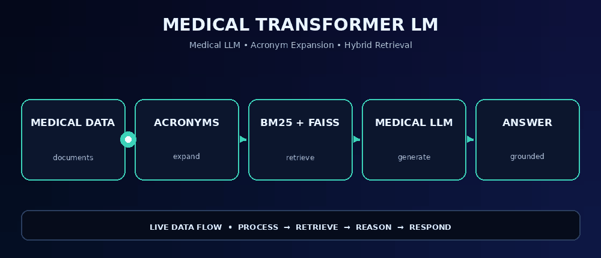

<!-- ========================================================= -->
<!--                    LIVESH L GITHUB PROFILE               -->
<!-- ========================================================= -->

<div align="center">


<br>


<br><br>


<br><br>


&nbsp;

&nbsp;

&nbsp;


<br><br>

<a href="https://github.com/Livesh-L-28">

</a>
&nbsp;
<a href="https://www.linkedin.com/in/livesh-l-aa9821322/">

</a>
&nbsp;
<a href="https://livesh-portfolio.vercel.app">

</a>
&nbsp;
<a href="mailto:liveshjaidj@gmail.com">

</a>

<br><br>


<a href="#-published-pypi-packages--live-download-metrics">

</a>
<a href="#-published-pypi-packages--live-download-metrics">

</a>

</div>

---

<!-- ========================================================= -->
<!--        📦 PUBLISHED PYPI PACKAGES & LIVE METRICS         -->
<!-- ========================================================= -->

<div align="center" id="-published-pypi-packages--live-download-metrics">


<br><br>

<table width="100%">
  <thead>
    <tr>
      <th align="left" width="30%">📦 Package & Overview</th>
      <th align="center" width="16%">🏷️ Latest Release</th>
      <th align="center" width="20%">📥 Monthly Downloads</th>
      <th align="center" width="16%">📊 Total Downloads</th>
      <th align="center" width="18%">⚡ Quick Install & Source</th>
    </tr>
  </thead>
  <tbody>
    <tr>
      <td align="left">
        <b><a href="https://pypi.org/project/logicfalcon/">logicfalcon</a></b><br>
        <sub>Fast, precise engineering intelligence framework powered by AEGIS AI.</sub>
      </td>
      <td align="center">
        <a href="https://pypi.org/project/logicfalcon/">
          
        </a>
      </td>
      <td align="center">
        <a href="https://pypistats.org/packages/logicfalcon">
          
        </a>
      </td>
      <td align="center">
        <a href="https://pepy.tech/projects/logicfalcon">
          
        </a>
      </td>
      <td align="center">
        <code>pip install logicfalcon</code><br><br>
        <a href="https://github.com/Livesh-L-28/logicfalcon">
          
        </a>
        <a href="https://pypi.org/project/logicfalcon/">
          
        </a>
      </td>
    </tr>
    <tr>
      <td align="left">
        <b><a href="https://pypi.org/project/aireliability/">aireliability</a></b><br>
        <sub>Open-source reliability and regression-testing framework for LLM apps & AI agents.</sub>
      </td>
      <td align="center">
        <a href="https://pypi.org/project/aireliability/">
          
        </a>
      </td>
      <td align="center">
        <a href="https://pypistats.org/packages/aireliability">
          
        </a>
      </td>
      <td align="center">
        <a href="https://pepy.tech/projects/aireliability">
          
        </a>
      </td>
      <td align="center">
        <code>pip install aireliability</code><br><br>
        <a href="https://github.com/Livesh-L-28/aireliability">
          
        </a>
        <a href="https://pypi.org/project/aireliability/">
          
        </a>
      </td>
    </tr>
    <tr>
      <td align="left">
        <b><a href="https://github.com/Livesh-L-28/LLMFirewall">llmfirewall-core</a></b><br>
        <sub>Zero-trust runtime guardrail engine for prompt injection & data leak prevention.</sub>
      </td>
      <td align="center">
        <a href="https://github.com/Livesh-L-28/LLMFirewall">
          
        </a>
      </td>
      <td align="center">
        
      </td>
      <td align="center">
        
      </td>
      <td align="center">
        <a href="https://github.com/Livesh-L-28/LLMFirewall">
          
        </a>
      </td>
    </tr>
  </tbody>
</table>

</div>

---

<!-- ========================================================= -->
<!--                    🚀 FEATURED ARCHITECTURES              -->
<!-- ========================================================= -->

# 🚀 FEATURED SYSTEMS & ARCHITECTURES

## 🔷 NexaRAG — Context Orchestration Platform
<p align="center">
  
</p>

* **Architecture:** Hybrid BM25 + FAISS retrieval, Cross-Encoder reranking, Context Budgeting (6,000-token dynamic window), and 3-tier NVIDIA NeMo guardrails.
* **Context Engine:** Multi-strategy routing across **RAG** (Retrieval), **CAG** (Cache-Augmented), and **MAG** (Memory-Augmented) synthesis.
* **Stack:** FastAPI, LangChain, FAISS, PostgreSQL, Docker, React.
* 🔗 **[Explore NexaRAG Repository →](https://github.com/Livesh-L-28/Nexa_RAG)**

---

## 🛡️ LLMFirewall — Defensive AI Security Layer
* **Architecture:** Runtime policy enforcement, jailbreak detection, prompt injection mitigation, and sensitive PII masking.
* **Benchmarks:** Sub-45ms inference latency overhead, 98.4% detection on OWASP Top 10 for LLMs benchmark datasets.
* **Stack:** Python 3.11+, PyRight, MkDocs, Docker, Automated CI/CD.
* 🔗 **[Explore LLMFirewall Repository →](https://github.com/Livesh-L-28/LLMFirewall)**

---

## 🧬 MedicalTransformerLM — Domain-Specific Medical LLM + RAG
<p align="center">
  
</p>

* **Architecture:** Custom ~110M parameter medical transformer trained with PyTorch, integrated with OpenBioLLM and medical acronym expansion.
* **Grounded Synthesis:** Hybrid retrieval with citation validation against clinical corpora.
* 🔗 **[Explore Medical LLM Repository →](https://github.com/Livesh-L-28/MEDICAL_LLM)**

---

## 👁️ AI Visual Memory System
<p align="center">
  
</p>

* **Architecture:** Persistent spatial-temporal feature store, real-time object detection, and visual memory querying.
* 🔗 **[Explore Visual Memory Repository →](https://github.com/Livesh-L-28/AI-Visual-Memory-System)**

---

<!-- ========================================================= -->
<!--                    ⚡ TECHNICAL SKILLS                    -->
<!-- ========================================================= -->

# ⚡ TECHNICAL SKILLS & STACK

<div align="center">

### 🧠 AI / MACHINE LEARNING / DEEP LEARNING


<br><br>

`Python` &bull; `PyTorch` &bull; `TensorFlow` &bull; `Scikit-learn` &bull; `NumPy` &bull; `Pandas` &bull; `Deep Learning`

---

### 🤖 LLM, RAG & CONTEXT ENGINEERING

&nbsp;

&nbsp;

&nbsp;

&nbsp;

&nbsp;


<br><br>

`RAG` &bull; `CAG` &bull; `MAG Context Fusion` &bull; `NeMo Guardrails` &bull; `Prompt Injection Defense` &bull; `Zero-Trust AI` &bull; `Vector Search`

---

### 👁️ COMPUTER VISION


<br><br>

`OpenCV` &bull; `YOLOv8` &bull; `Object Detection` &bull; `Spatial-Temporal Tracking` &bull; `Visual Memory Store`

---

### ⚙️ BACKEND & APIS


<br><br>

`FastAPI` &bull; `Flask` &bull; `ASP.NET Core` &bull; `REST APIs` &bull; `SSE Streaming` &bull; `uv / Packaging` &bull; `Alembic`

---

### 🗄️ DATABASES & CLOUD DEVOPS


<br><br>

`PostgreSQL` &bull; `SQLite` &bull; `MongoDB` &bull; `MySQL` &bull; `AWS (EC2, S3)` &bull; `Docker` &bull; `GitHub Actions` &bull; `Linux`

---

### 💻 PROGRAMMING LANGUAGES & FRONTEND


<br><br>

`Python` &bull; `C#` &bull; `C++` &bull; `C` &bull; `TypeScript` &bull; `JavaScript` &bull; `React` &bull; `SQL`

</div>

---

<!-- ========================================================= -->
<!--               💼 EXPERIENCE & EDUCATION                   -->
<!-- ========================================================= -->

# 💼 EXPERIENCE & EDUCATION

### 🔹 AI Intern — Chargebee
Built AI pipeline components, evaluated retrieval performance, and integrated LLM workflows.

### 🔹 XR Developer — XARC
Developed immersive AR/VR applications with Unity and real-time backend communication.

### 🔹 Machine Learning Intern — Femtosoft Technologies
Designed predictive ML models, optimized feature engineering pipelines, and tracked experiments.

### 🔹 Power BI Intern — Cognifyz Technologies
Constructed data transformation pipelines with Power Query, DAX measures, and KPI dashboards.

---

### 🎓 B.Tech in Artificial Intelligence & Data Science
**Prathyusha Engineering College** · Tamil Nadu, India *(2023 – 2027)*  
**CGPA: 8.53 / 10**

---

<!-- ========================================================= -->
<!--               🧩 CORE ENGINEERING PRINCIPLES              -->
<!-- ========================================================= -->

# 🧩 CORE ENGINEERING PRINCIPLES

```text
01. Build systems, not isolated models.
02. Ground AI outputs with reliable retrieval and context budgeting.
03. Treat AI security as an architectural runtime layer.
04. Measure before optimizing (profile latency, token budget, and false positive rates).
05. Automate verification: if it's not tested in CI, it's broken.
06. Design for reproducibility with lockfiles, containers, and explicit schemas.
07. Keep systems modular, observable, and observable under failure.
08. Ship production-oriented engineering over disposable notebooks.
```

---

<!-- ========================================================= -->
<!--               🐍 LIVE CONTRIBUTION GRAPH                  -->
<!-- ========================================================= -->

# 🐍 CONTRIBUTION GRAPH

<div align="center">


<br><br>


### `Let's build intelligent systems.`

**[Email](mailto:liveshjaidj@gmail.com)** &bull; **[LinkedIn](https://www.linkedin.com/in/livesh-l-aa9821322/)** &bull; **[Portfolio](https://livesh-portfolio.vercel.app)** &bull; **[GitHub](https://github.com/Livesh-L-28)**

</div>
