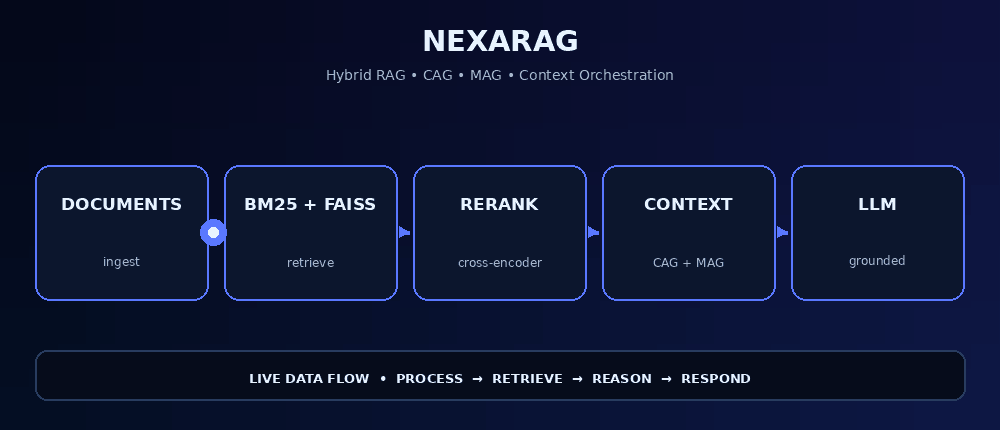
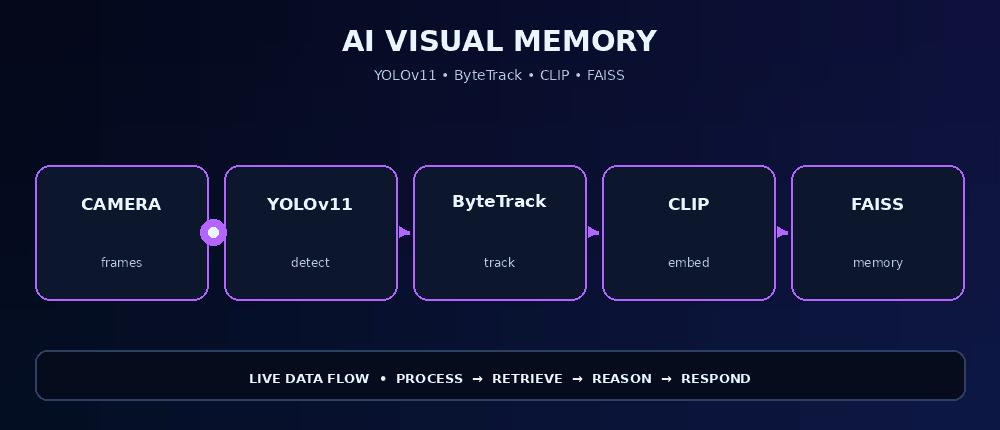
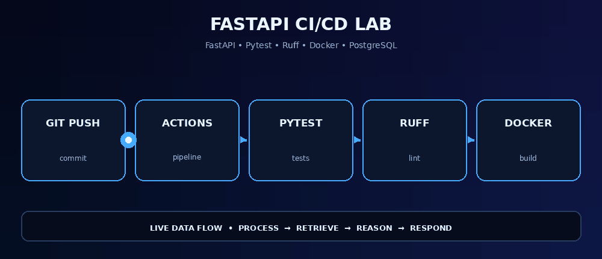
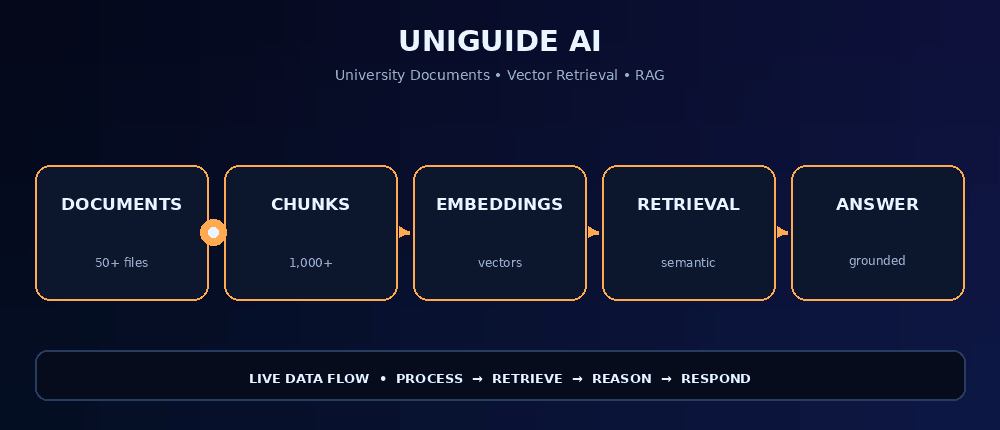
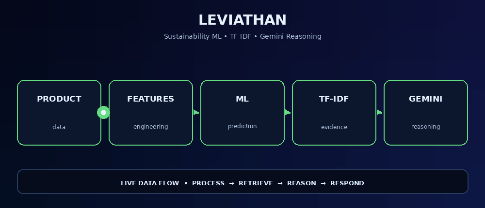

<!-- ========================================================= -->
<!--                    LIVESH L GITHUB PROFILE               -->
<!-- ========================================================= -->

<div align="center">


<br>


<br><br>


<br><br>


<br><br>

<a href="https://github.com/Livesh-L-28">

</a>

<a href="https://www.linkedin.com/in/livesh-l-aa9821322/">

</a>

<a href="mailto:liveshjaidj@gmail.com">

</a>

<br><br>


<a href="#-published-pypi-packages--live-download-metrics">

</a>
<a href="#-published-pypi-packages--live-download-metrics">

</a>

</div>

---

<!-- ========================================================= -->
<!--        📦 PUBLISHED PYPI PACKAGES & LIVE METRICS         -->
<!-- ========================================================= -->

<div align="center" id="-published-pypi-packages--live-download-metrics">


<br><br>


<br><br>

<table width="100%">
  <thead>
    <tr>
      <th align="left" width="30%">📦 Package & Overview</th>
      <th align="center" width="16%">🏷️ Latest Release</th>
      <th align="center" width="20%">📥 Monthly Downloads</th>
      <th align="center" width="16%">📊 Total Downloads</th>
      <th align="center" width="18%">⚡ Quick Install & Source</th>
    </tr>
  </thead>
  <tbody>
    <tr>
      <td align="left">
        <b><a href="https://pypi.org/project/logicfalcon/">logicfalcon</a></b><br>
        <sub>LogicFalcon — Fast, precise engineering intelligence. Powered by AEGIS AI.</sub>
      </td>
      <td align="center">
        <a href="https://pypi.org/project/logicfalcon/">
          
        </a>
      </td>
      <td align="center">
        <a href="https://pypistats.org/packages/logicfalcon">
          
        </a>
      </td>
      <td align="center">
        <a href="https://pepy.tech/projects/logicfalcon">
          
        </a>
      </td>
      <td align="center">
        <code>pip install logicfalcon</code><br><br>
        <a href="https://github.com/Livesh-L-28/logicfalcon">
          
        </a>
        <a href="https://pypi.org/project/logicfalcon/">
          
        </a>
      </td>
    </tr>
    <tr>
      <td align="left">
        <b><a href="https://pypi.org/project/aireliability/">aireliability</a></b><br>
        <sub>Open-source reliability and regression-testing framework for LLM apps & AI agents.</sub>
      </td>
      <td align="center">
        <a href="https://pypi.org/project/aireliability/">
          
        </a>
      </td>
      <td align="center">
        <a href="https://pypistats.org/packages/aireliability">
          
        </a>
      </td>
      <td align="center">
        <a href="https://pepy.tech/projects/aireliability">
          
        </a>
      </td>
      <td align="center">
        <code>pip install aireliability</code><br><br>
        <a href="https://github.com/aireliability/aireliability">
          
        </a>
        <a href="https://pypi.org/project/aireliability/">
          
        </a>
      </td>
    </tr>
    <tr>
      <td align="left">
        <b><a href="https://pypi.org/project/llmfirewall-core/">llmfirewall-core</a></b><br>
        <sub>Lightweight, provider-agnostic security & policy enforcement layer for LLMs, RAG & agents.</sub>
      </td>
      <td align="center">
        <a href="https://pypi.org/project/llmfirewall-core/">
          
        </a>
      </td>
      <td align="center">
        <a href="https://pypistats.org/packages/llmfirewall-core">
          
        </a>
      </td>
      <td align="center">
        <a href="https://pepy.tech/projects/llmfirewall-core">
          
        </a>
      </td>
      <td align="center">
        <code>pip install llmfirewall-core</code><br><br>
        <a href="https://github.com/Livesh-L-28/LLMFirewall">
          
        </a>
        <a href="https://pypi.org/project/llmfirewall-core/">
          
        </a>
      </td>
    </tr>
    <tr>
      <td align="left">
        <b><a href="https://pypi.org/project/aegis-resilience/">aegis-resilience</a></b><br>
        <sub>Autonomous reliability engineering framework for AI incident investigation & remediation.</sub>
      </td>
      <td align="center">
        <a href="https://pypi.org/project/aegis-resilience/">
          
        </a>
      </td>
      <td align="center">
        <a href="https://pypistats.org/packages/aegis-resilience">
          
        </a>
      </td>
      <td align="center">
        <a href="https://pepy.tech/projects/aegis-resilience">
          
        </a>
      </td>
      <td align="center">
        <code>pip install aegis-resilience</code><br><br>
        <a href="https://github.com/Livesh-L-28/AEGIS-Framework">
          
        </a>
        <a href="https://pypi.org/project/aegis-resilience/">
          
        </a>
      </td>
    </tr>
  </tbody>
</table>

<br>

</div>

---

<!-- ========================================================= -->
<!--                    AI ENGINEERING CORE                    -->
<!-- ========================================================= -->

<div align="center">


<br><br>


<br><br>

<table width="100%">
<tr>

<td align="center" width="20%">

### ◈

## LLM

`Transformers`

`OpenBioLLM`

`Medical LLM`

</td>

<td align="center" width="20%">

### ◇

## RAG

`BM25`

`FAISS`

`Hybrid Retrieval`

</td>

<td align="center" width="20%">

### ◆

## CONTEXT

`CAG`

`MAG`

`Context Fusion`

</td>

<td align="center" width="20%">

### ⬡

## SECURITY

`Guardrails`

`Prompt Injection`

`Safety`

</td>

<td align="center" width="20%">

### ◉

## SYSTEMS

`FastAPI`

`Docker`

`PostgreSQL`

</td>

</tr>
</table>

<br>

```text
                         ╔══════════════════════╗
                         ║    INTELLIGENT AI    ║
                         ║        CORE          ║
                         ╚══════════╤═══════════╝
                                    │
              ┌─────────────────────┼─────────────────────┐
              │                     │                     │
              ▼                     ▼                     ▼
        ┌───────────┐         ┌───────────┐         ┌───────────┐
        │    LLM    │         │    RAG    │         │    CV     │
        │           │         │           │         │           │
        │ Models    │         │ Retrieval │         │ Vision    │
        │ Agents    │         │ Vector DB │         │ Detection │
        └─────┬─────┘         └─────┬─────┘         └─────┬─────┘
              │                     │                     │
              └─────────────────────┼─────────────────────┘
                                    │
                                    ▼
                         ╔══════════════════════╗
                         ║ CONTEXT ENGINEERING  ║
                         ║                      ║
                         ║ RAG • CAG • MAG      ║
                         ║ MEMORY • FUSION      ║
                         ╚══════════╤═══════════╝
                                    │
                                    ▼
                         ╔══════════════════════╗
                         ║    AI GUARDRAILS     ║
                         ║                      ║
                         ║ INPUT • RETRIEVAL    ║
                         ║ DIALOG • OUTPUT      ║
                         ╚══════════╤═══════════╝
                                    │
                                    ▼
                         ╔══════════════════════╗
                         ║   PRODUCTION AI      ║
                         ║                      ║
                         ║ API • CLOUD • CI/CD  ║
                         ╚══════════════════════╝
<div align="center">

<!-- HERO -->


### `AI / LLM ENGINEER`

**Building intelligent systems across LLMs, RAG, Context Engineering, AI Security, Computer Vision, Backend & Cloud.**

<br>


<br>

<a href="https://github.com/Livesh-L-28">

</a>
<a href="https://www.linkedin.com/in/livesh-l-aa9821322/">

</a>
<a href="mailto:liveshjaidj@gmail.com">

</a>

</div>

---

# 🧠 ABOUT ME

```text
AI Forward Engineer focused on building production-oriented intelligent systems.

→ Large Language Models
→ Retrieval-Augmented Generation
→ Context Engineering
→ AI Security & Guardrails
→ Computer Vision
→ Backend Engineering
→ Cloud & DevOps

I enjoy turning AI models into modular, secure, observable and deployable systems.
```

<div align="center">

### `BUILD  →  MEASURE  →  SECURE  →  SHIP`

</div>

---

# ⚡ TECHNICAL SKILLS

<div align="center">

### 🧠 AI / MACHINE LEARNING


<br><br>

`Python` · `PyTorch` · `TensorFlow` · `Scikit-learn` · `NumPy` · `Pandas` · `Matplotlib` · `Deep Learning`

---

### 🤖 LLM / GENERATIVE AI


<br>

`LLMs` · `Transformers` · `OpenBioLLM` · `Gemini` · `Prompt Engineering` · `Medical LLM`

---

### 🔎 RAG / CONTEXT ENGINEERING


<br><br>

`RAG` · `BM25` · `FAISS` · `ChromaDB` · `LangChain` · `Cross-Encoder`
`CAG` · `MAG` · `Context Orchestration` · `Context Fusion`

---

### 🛡️ AI SECURITY


<br><br>

`NVIDIA NeMo Guardrails` · `Prompt Injection Protection`
`Retrieval Guardrails` · `Output Guardrails` · `Tenant Isolation`

---

### 👁️ COMPUTER VISION


<br>

`OpenCV` · `YOLOv11` · `ByteTrack` · `CLIP`

---

### ⚙️ BACKEND / APIs


<br>

`FastAPI` · `Flask` · `REST APIs` · `JWT` · `Microservices` · `Unit Testing`

---

### 🎨 FRONTEND


<br>

`React` · `TypeScript` · `Tailwind CSS` · `D3.js`

---

### 🗄️ DATABASES


<br>

`PostgreSQL` · `MySQL` · `SQLite`

---

### ☁️ CLOUD / DEVOPS


<br>

`AWS S3` · `Docker` · `GitHub Actions` · `Git` · `Linux` · `CI/CD`

---

### 💻 PROGRAMMING


<br>

`Python` · `Java` · `C#` · `JavaScript` · `TypeScript` · `SQL`

</div>

---

# 🚀 FEATURED PROJECTS

<div align="center">


</div>

## 🔷 NexaRAG
<p align="center">
  
</p>

### `RAG + CAG + MAG + Context Orchestration Platform`

A modular, production-oriented RAG architecture designed around:

```text
DOCUMENTS
    ↓
INGESTION
    ↓
CHUNKING
    ↓
EMBEDDINGS
    ↓
┌──────────────────────────────┐
│       HYBRID RETRIEVAL       │
│                              │
│       BM25 + FAISS           │
└──────────────┬───────────────┘
               ↓
        CROSS ENCODER
               ↓
┌──────────────────────────────┐
│    CONTEXT ORCHESTRATION     │
│                              │
│  RAG + CAG + MAG + FUSION    │
└──────────────┬───────────────┘
               ↓
        AI GUARDRAILS
               ↓
          LLM PROVIDER
               ↓
       GROUNDED RESPONSE
               ↓
           CITATIONS
```

**Architecture highlights**

* Hybrid BM25 + FAISS retrieval
* Cross-encoder reranking
* Cache-Augmented Generation
* Memory-Augmented Generation
* Context orchestration
* Context fusion
* NVIDIA NeMo Guardrails
* Prompt-injection protection
* Retrieval and output safety
* Tenant isolation
* PostgreSQL
* Observability

🔗 **[View NexaRAG →](https://github.com/Livesh-L-28/Nexa_RAG)**

---

## 🧬 MedicalTransformerLM
<p align="center">
  
</p>

### `Domain-Specific Medical LLM + RAG`

A custom medical language model architecture combined with retrieval and grounded synthesis.

**Core system**

```text
Medical Documents
       ↓
   BM25 + FAISS
       ↓
 Medical Acronym Expansion
       ↓
    Retrieval
       ↓
 Context Construction
       ↓
 MedicalTransformerLM
       ↓
 Grounded Response
```

**Highlights**

* ~110M parameter MedicalTransformerLM
* PyTorch
* OpenBioLLM
* Hybrid retrieval
* BM25
* FAISS
* Medical acronym expansion
* RAG-based synthesis

🔗 **[View Medical LLM →](https://github.com/Livesh-L-28/MEDICAL_LLM)**

---

## 👁️ AI Visual Memory System
<p align="center">
  
</p>

### `Computer Vision + Persistent Visual Memory`

```text
Camera
  ↓
YOLOv11
  ↓
ByteTrack
  ↓
CLIP Embeddings
  ↓
FAISS
  ↓
Persistent Visual Memory
  ↓
Semantic Search
```

**Performance**

> ~30–50 ms/frame

**Stack**

`YOLOv11` · `ByteTrack` · `CLIP` · `FAISS` · `FastAPI` · `React` · `Docker`

🔗 **[View AI Visual Memory →](https://github.com/Livesh-L-28/AI-Visual-Memory-System)**

---

## ⚙️ FastAPI CI/CD Lab
<p align="center">
  
</p>

### `Backend + Docker + Automated CI/CD`

```text
Developer
    ↓
Git Push
    ↓
GitHub Actions
    ↓
Tests
    ↓
Ruff
    ↓
Docker Build
    ↓
PostgreSQL
    ↓
Deployment Validation
```

**Stack**

`FastAPI` · `Pytest` · `Ruff` · `PostgreSQL` · `Docker` · `GitHub Actions`

🔗 **[View CI/CD Lab →](https://github.com/Livesh-L-28/fastapi-cicd-lab)**

---

## 🎓 UniGuide AI
<p align="center">
  
</p>

### `RAG-Based University Assistant`

* 50+ documents
* 1,000+ vector chunks
* RAG pipeline
* Reported 92–96% query accuracy

🔗 **[View UniGuide AI →](https://github.com/Livesh-L-28/RAG_DOCUMENT)**

---

## 🌱 Leviathan
<p align="center">
  
</p>

### `AI Sustainability & Anti-Greenwashing Platform`

Machine-learning based sustainability analysis platform combining:

`Scikit-learn` + `TF-IDF` + `Gemini reasoning` + product data APIs

Reported:

```text
R² = 0.88
```

---

# 📊 ENGINEERING METRICS

<div align="center">

<table>
<tr>

<td align="center" width="25%">

### `~110M`

**PARAMETERS**

Medical LLM

</td>

<td align="center" width="25%">

### `92–96%`

**ACCURACY**

UniGuide AI

</td>

<td align="center" width="25%">

### `30–50ms`

**PER FRAME**

Visual Memory

</td>

<td align="center" width="25%">

### `0.88`

**R²**

Leviathan

</td>

</tr>
</table>

</div>

---

# 💼 EXPERIENCE

### 🔹 AI Intern — Chargebee

`Feb 2026 – Aug 2026`

Built **Leviathan**, an AI-powered sustainability and anti-greenwashing audit platform using ensemble ML, TF-IDF + Gemini reasoning and product-data APIs.

---

### 🔹 XR Developer — XARC

`May 2026 – Aug 2026`

Engineered the **XARC Nexus Aggregator Desktop Client** using React, TypeScript, Electron, Unity Addressables and AWS S3.

---

### 🔹 Machine Learning Intern — Femtosoft Technologies

`Jul 2025 – Aug 2025`

Worked across data collection, preprocessing, EDA, feature engineering, model training and evaluation.

---

### 🔹 Power BI Intern — Cognifyz Technologies

`Sep 2024 – Oct 2024`

Built dashboards, Power Query transformations, DAX measures and KPI reporting.

---

# 🎓 EDUCATION

<div align="center">

### B.Tech — Artificial Intelligence & Data Science

**Prathyusha Engineering College · Tamil Nadu**

`2023 – 2027`

### `CGPA 8.53 / 10`

</div>

---

# 🧩 ENGINEERING PRINCIPLES

```text
┌─────────────────────────────────────────────────────────────┐
│                                                             │
│  01  Build systems, not isolated models.                   │
│                                                             │
│  02  Ground AI outputs with reliable retrieval.             │
│                                                             │
│  03  Treat AI security as an architectural layer.          │
│                                                             │
│  04  Measure before optimizing.                             │
│                                                             │
│  05  Automate testing and delivery.                         │
│                                                             │
│  06  Design for reproducibility.                            │
│                                                             │
│  07  Keep systems modular and observable.                   │
│                                                             │
│  08  Ship production-oriented engineering.                  │
│                                                             │
└─────────────────────────────────────────────────────────────┘
```

---

# 📈 GITHUB ACTIVITY

<div align="center">


</div>

<br>

<div align="center">


</div>

---

# 🐍 CONTRIBUTION GRAPH

<div align="center">


</div>

---

<div align="center">


### `Let's build intelligent systems.`

<a href="mailto:liveshjaidj@gmail.com">Contact Me →</a>

</div>
